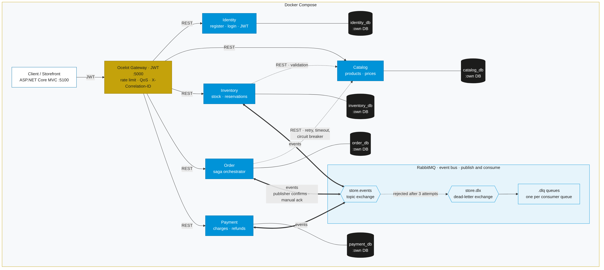

# Store Platform Capstone

**CruzDusty_StorePlatformCapstone**: an online campus store built as .NET 10 microservices
behind a single Ocelot API gateway. Customers browse products, register, sign in and place
orders. Each order is carried through stock reservation and payment by an orchestrated saga
over RabbitMQ, which compensates automatically when a step fails. The Storefront lets you
switch failures on and off and watch every step live.

Capstone project · UST Angelicum College



## Team

| Member | GitHub | Owns |
| --- | --- | --- |
| Dusty Cruz | [@dustycruz](https://github.com/dustycruz) | Catalog service, `Store.Observability`, Ocelot gateway, Docker Compose, Catalog clients and resilience, correlation ids over RabbitMQ, architecture docs |
| Laurence Mirandilla | [@LaurenceMirandilla](https://github.com/LaurenceMirandilla) | Inventory and Payment services, `Store.Messaging`, `Store.Contracts.Events`, RabbitMQ in Compose, Postman collection, `flows.http` |
| CJ Bello | [@CJ-Bello](https://github.com/CJ-Bello) | Identity and Order services, the order saga, gateway security routes, Storefront, evidence checklist |

## What is inside

| Part | Responsibility |
| --- | --- |
| **Identity** | Register and log in; issues JWTs with the roles `Customer` and `Admin` |
| **Catalog** | Products (name, price, active flag); the source of truth for what can be sold |
| **Inventory** | Stock on hand and reservations per product |
| **Order** | Orders, lines and status history; orchestrates the saga |
| **Payment** | Charges and refunds, with an on-demand failure switch |
| **Gateway** | Ocelot: the only API entry point; JWT validation, Admin claim checks, login rate limit, QoS |
| **Storefront** | ASP.NET Core MVC site that talks only to the gateway |
| **RabbitMQ** | Topic exchange `store.events`, dead-letter exchange `store.dlx`, one `.dlq` per queue |
| **PostgreSQL** | One PostgreSQL 16 container per service (database-per-service) |

More detail: [docs/architecture.md](docs/architecture.md) (components, saga sequence diagrams,
resilience, security) and [docs/messaging.md](docs/messaging.md) (exchanges, queues, retries,
dead-lettering, idempotency).

## Prerequisites

- Windows 10/11, macOS or Linux with [Docker Desktop](https://www.docker.com/products/docker-desktop/) (Docker Compose v2) running
- Git
- About 4 GB of free memory for the 13 containers
- Optional: the [.NET 10 SDK](https://dotnet.microsoft.com/download/dotnet/10.0) to build outside Docker, Postman or the VS Code REST Client extension

## Run it

```cmd
git clone https://github.com/dustycruz/CruzDusty_StorePlatformCapstone.git
cd CruzDusty_StorePlatformCapstone
setup.cmd
docker compose up --build
```

`setup.cmd` checks Docker, creates `.env` from `.env.example` (never overwriting an existing
`.env`) and validates the Compose file. On macOS or Linux, run `cp .env.example .env` instead.

The first build takes a few minutes. When `docker compose ps` shows every service as
`healthy`, open the Storefront at <http://localhost:5100>.

Stop with `docker compose down`. Use `docker compose down -v` to also delete the databases;
the next start migrates and seeds them again.

## Port map

| Address | What |
| --- | --- |
| <http://localhost:5100> | Storefront |
| <http://localhost:5000> | API gateway: the only entry point for API calls |
| <http://localhost:15672> | RabbitMQ management UI (`guest` / `guest`) |
| <http://localhost:5001/swagger> | Identity Swagger UI (Development) |
| <http://localhost:5002/swagger> | Catalog Swagger UI (Development) |
| <http://localhost:5003/swagger> | Inventory Swagger UI (Development) |
| <http://localhost:5004/swagger> | Order Swagger UI (Development) |
| <http://localhost:5005/swagger> | Payment Swagger UI (Development) |

Databases are not published to the host. Gateway routes follow `/<service>/v1/<resource>`
(`identity`, `catalog`, `inventory`, `orders`, `payments`), for example
`GET /catalog/v1/products`. Services expose `api/v{version}/<resource>` internally.

## Demo accounts

Seeded at first start from `.env` (local-development values only):

| Role | Email | Password |
| --- | --- | --- |
| Admin | `admin@storeplatform.local` | `Admin@12345` |
| Customer | `customer@storeplatform.local` | `Customer@12345` |

New registrations always get the `Customer` role. The catalog is seeded with 11 products,
10 of them active. **Varsity Jacket - Limited Edition** has exactly one unit in stock, for the
insufficient-stock demo.

## Demo walkthrough (everything through the gateway)

1. **Browse**: open <http://localhost:5100> without signing in.
2. **Sign in** as the customer, add items to the cart, check out. The order page shows the
   timeline `Order placed → Stock reserved → Payment charged → Order confirmed`, updated
   every 2 seconds.
3. **Insufficient stock**: order 2 × Varsity Jacket. Result: Cancelled, nothing charged.
4. **Compensation**: sign in as the admin and open **Admin → Chaos & Saga Testing**.
   - Turn on **DeclineCharge**, then order as the customer: stock released, Cancelled.
   - Turn it off, turn on **FailAfterPayment**, and order again: charged, refunded, stock
     released, Cancelled. Compensation steps are drawn in red.
5. **Retry**: set Catalog chaos to 50% and place orders. They still succeed;
   `docker compose logs order-api` shows `Retrying Catalog call ...`.
6. **Blocked admin action**: as the customer, open `/Admin/Chaos` (403 page), or call an admin
   route through the gateway (`401` without a token, `403` with a customer token).

The same flows are scripted in [`postman/`](postman/README.md) (run with Newman) and
[`http/flows.http`](http/flows.http) (VS Code REST Client).

## Eventual consistency

There is no distributed transaction. Each service commits only to its own database, and the
services agree by exchanging events. The consequences:

- **Order status vs. stock vs. payment.** Right after `POST /orders/v1/orders` the order is
  `Pending` while Inventory has not reserved anything yet. For a short time the three databases
  disagree: Inventory may already hold stock for an order whose status still says
  `StockReserved`, or Payment may have charged an order that is about to be compensated. The
  saga always drives them to one of two consistent end states:
  - `Confirmed`: stock committed (sold), payment `Charged`
  - `Cancelled`: no stock held, payment never taken, or `Declined`, or `Refunded`
- **Why 202 Accepted.** Placing an order returns `202` because the outcome is not known yet.
  Clients poll `GET /orders/v1/orders/{id}`; the Storefront polls every 2 seconds.
- **Price snapshot on lines.** Each order line copies the SKU, name and unit price from Catalog
  at the moment the order is placed. Later price changes in Catalog never change an existing
  order, and the order total cannot drift while the saga runs.
- **Stock as shown in the shop** is a read of Inventory at page-load time. Two customers can
  both see "1 left"; the reservation step decides who gets it, and the other order is
  cancelled with a clear reason.
- **Guarantees that make this safe.** Events are persistent and published with publisher
  confirms. Consumers ack manually, retry, and dead-letter what keeps failing, so nothing
  is lost silently. Every consumer records processed message ids in the same transaction as
  its change (idempotency), and the saga ignores replies for steps it has already passed.

## Testing assets

| Path | What |
| --- | --- |
| `postman/StorePlatform.postman_collection.json` + `..._environment.json` | 35 requests and 73 assertions: browse, register, login (saves tokens), successful order, failure modes, compensated orders, status history, 401/403, chaos + retry, login 429 |
| `http/flows.http` | The same flows for the VS Code REST Client |
| `Evidence/README.md` | Evidence checklist, capture instructions and the demo script |

```bash
npx newman run postman/StorePlatform.postman_collection.json -e postman/StorePlatform.postman_environment.json
```

## Build without Docker

```cmd
dotnet build CruzDusty_StorePlatformCapstone.slnx
```

The services expect PostgreSQL and RabbitMQ, so the supported way to run them is Docker Compose.

## Tech stack

- **.NET 10** for every project, with central package management (`Directory.Packages.props`)
- ASP.NET Core Web API, `Asp.Versioning` (URL segment), per-version Swagger UI (Swashbuckle)
- Contract-first OpenAPI 3.0 (`contracts/*.v1.yaml`) with clients generated by `NSwag.ApiDescription.Client`
- `Microsoft.Extensions.Http.Resilience` (retry, timeouts, circuit breaker)
- `RabbitMQ.Client` 7 (async API) with publisher confirms, manual ack, dead-letter queues
- EF Core 10 + Npgsql, migrations applied at startup with retry
- **Ocelot 24.1 + Ocelot.Provider.Polly 24.1.** Ocelot 25 supports .NET 10, but its Polly
  provider has no stable 25.x release yet, so the gateway uses the matching 24.1 pair; its
  `net9.0` assemblies run on .NET 10. All projects stay on .NET 10.
- ASP.NET Core MVC, Bootstrap 5, Bootstrap Icons, Google Fonts (Cinzel, Inter)

## Configuration

All configuration comes from environment variables in `.env`. `.env.example` is the
committed template with **local-development values only**; `.env` is gitignored.

| Group | Variables |
| --- | --- |
| Ports | `GATEWAY_PORT`, `STOREFRONT_PORT`, `IDENTITY_API_PORT` … `PAYMENT_API_PORT`, `RABBITMQ_MANAGEMENT_PORT` |
| JWT | `JWT_KEY` (≥ 32 characters), `JWT_ISSUER`, `JWT_AUDIENCE`, `JWT_EXPIRY_MINUTES` |
| RabbitMQ | `RABBITMQ_HOST`, `RABBITMQ_PORT`, `RABBITMQ_USER`, `RABBITMQ_PASSWORD`, `RABBITMQ_EXCHANGE`, `RABBITMQ_DEAD_LETTER_EXCHANGE`, `RABBITMQ_MAX_DELIVERY_ATTEMPTS` |
| Databases | `<SERVICE>_DB_HOST`, `_NAME`, `_USER`, `_PASSWORD` for `IDENTITY`, `CATALOG`, `INVENTORY`, `ORDER`, `PAYMENT` |
| Demo accounts | `SEED_ADMIN_EMAIL`, `SEED_ADMIN_PASSWORD`, `SEED_CUSTOMER_EMAIL`, `SEED_CUSTOMER_PASSWORD` |

## Troubleshooting

| Symptom | Fix |
| --- | --- |
| `port is already allocated` | Another program uses 5000-5005, 5100 or 15672. Change the matching `*_PORT` in `.env`, or stop the other program. |
| A service stays `starting` or `unhealthy` | `docker compose logs <service>`. Services retry the database and broker while those start; give them a minute on the first run. |
| Login answers **429 Too many login attempts** | The gateway allows 5 logins per minute per client address. Wait a minute. Storefront logins all come from the Storefront container, so they share one allowance. |
| Orders stay `Pending` | RabbitMQ or a consumer is down: `docker compose ps`, then check the queues in the management UI. Messages wait in their durable queues and are processed once the consumer is back. |
| Every order is cancelled | A failure switch is on. Turn it off on **Admin → Chaos & Saga Testing**, or `PUT /payments/v1/admin/failure-mode` and `/orders/v1/admin/failure-mode` with `{"mode":"None"}`. |
| Orders fail with 503 "The Catalog service is temporarily unavailable" | Catalog chaos is high. Reset it on the Chaos page (`failureRate: 0`) and wait 15 seconds for the circuit to close. |
| Changed `.env` but nothing changed | `docker compose up -d` recreates the containers with the new values. Seeded accounts are created only once, so use `docker compose down -v` to reseed. |
| The Storefront shows a placeholder crest instead of the logo | Add `src/Storefront/Storefront.Web/wwwroot/images/logo.png` and rebuild the storefront image. |
| Stale data after experimenting | `docker compose down -v` then `docker compose up --build` gives a clean, freshly seeded system. |

## Repository layout

```text
CruzDusty_StorePlatformCapstone.slnx   Solution (slnx format)
Directory.Build.props                  Shared build settings (net10.0)
Directory.Packages.props               Central NuGet versions
docker-compose.yml                     The whole platform
.env.example / setup.cmd               Local configuration and setup
contracts/                             OpenAPI contracts (*.v1.yaml)
docs/                                  Architecture and messaging documentation, diagrams
postman/  http/                        Postman collection and REST Client flows
Evidence/                              Evidence checklist and demo script
src/Gateway/Gateway.Api                Ocelot gateway
src/Services/<Name>/<Name>.Api         Identity, Catalog, Inventory, Order, Payment
src/Shared/                            Store.Contracts.Events, Store.Messaging, Store.Observability
src/Storefront/Storefront.Web          MVC storefront
```

## How we work

- Commits follow Conventional Commits (`feat(catalog): ...`, `fix(saga): ...`, `docs(readme): ...`).
- `dotnet build CruzDusty_StorePlatformCapstone.slnx` must pass with zero errors before every push.
- Contracts come first: controllers match `contracts/*.v1.yaml` (paths, operationIds, schemas, status codes).
- Each member's contributions are listed in [CONTRIBUTIONS.md](CONTRIBUTIONS.md).
