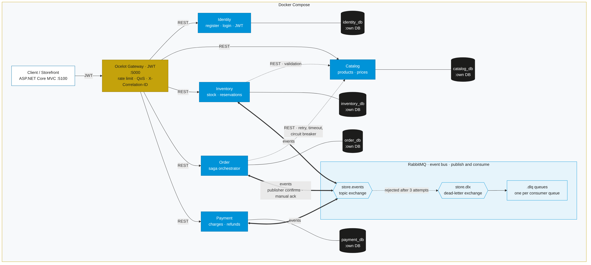
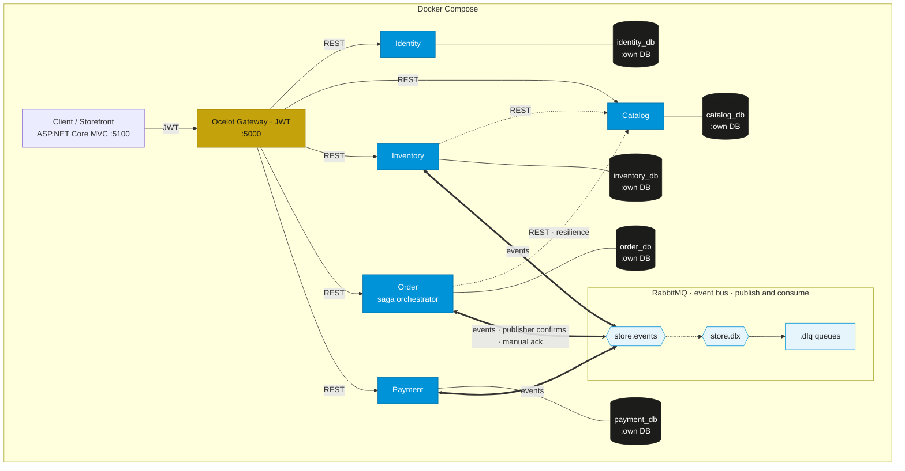
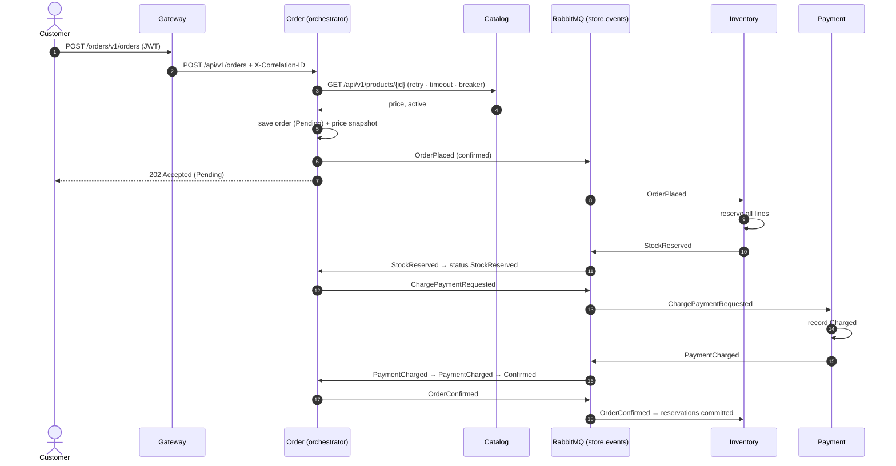
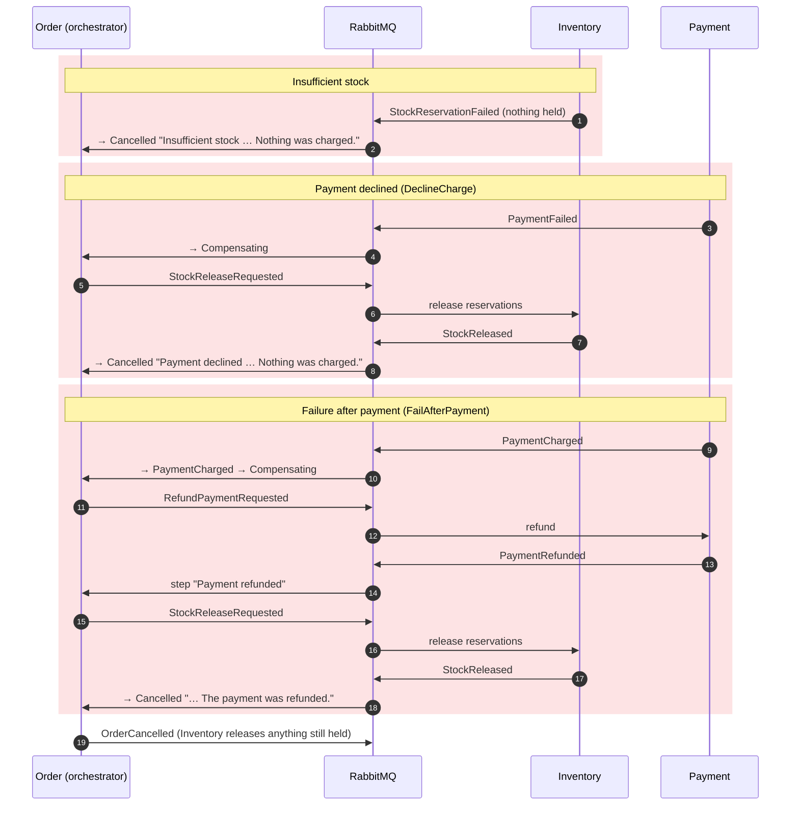

# Architecture

The Store Platform is five ASP.NET Core services behind one Ocelot gateway, with an MVC
Storefront, a RabbitMQ event bus and one PostgreSQL database per service, all started by one
`docker-compose.yml`.



The diagram source is [`architecture.mmd`](architecture.mmd). Re-export the PNG with:

```bash
npx -y @mermaid-js/mermaid-cli -i docs/architecture.mmd -o docs/architecture.png -w 1800 -s 2 -b white
```



## Components

| Component | Responsibility | Talks to |
| --- | --- | --- |
| Storefront (`Storefront.Web`) | MVC site. Keeps the JWT in an HttpOnly cookie and sends it as Bearer. | Gateway only, through clients generated from all five contracts |
| Gateway (`Gateway.Api`) | Ocelot: the single API entry point. Validates JWTs, enforces `role=Admin` on admin routes, rate-limits login, applies Polly QoS, creates `X-Correlation-ID`. | Every service over REST |
| Identity | Registration, login, JWT issuing (roles `Customer`, `Admin`) | `identity_db` |
| Catalog | Products and prices; source of truth for what can be sold. Development-only chaos switch. | `catalog_db` |
| Inventory | Stock on hand, reservations, adjustments | `inventory_db`, Catalog (REST), RabbitMQ |
| Order | Orders, lines, status history; orchestrates the saga | `order_db`, Catalog (REST), RabbitMQ |
| Payment | Charges, refunds, failure switch | `payment_db`, RabbitMQ |

Shared libraries: `Store.Contracts.Events` (event records), `Store.Messaging` (RabbitMQ
plumbing, see [messaging.md](messaging.md)), and `Store.Observability` (correlation ids,
Problem Details, logging scopes).

## Contracts first

The OpenAPI 3.0 contracts in `contracts/` were merged before any controller was written.
Controllers use the same paths (`api/v{version}/...`), operationIds (action names),
schemas and status codes. Every cross-service and Storefront call goes through a client
generated from a contract by `NSwag.ApiDescription.Client` at build time:

| Caller | Generated client | Contract |
| --- | --- | --- |
| Order.Api, Inventory.Api | `CatalogClient` | `catalog.v1.yaml` |
| Storefront.Web | `CatalogClient`, `IdentityClient`, `InventoryClient`, `OrderClient`, `PaymentClient` | all five |

The gateway exposes each operation as `/<service>/v1/<resource>` (`identity`, `catalog`,
`inventory`, `orders`, `payments`). The Storefront's `GatewayRouteHandler` rewrites the
contract path `/api/v1/...` to that prefix.

## Synchronous calls and resilience

Order (placing an order) and Inventory (stock adjustments) look products up in Catalog
through typed `HttpClient`s with `AddStandardResilienceHandler`, configured explicitly:

| Policy | Setting |
| --- | --- |
| Retry | 3 retries, exponential backoff from 300 ms, with jitter; every retry is logged |
| Attempt timeout | 2 s |
| Total timeout | 10 s |
| Circuit breaker | opens at 80% failures over at least 10 calls in 30 s, for 15 s |

The adapter (`CatalogProductLookup`) turns a 404 into a `NotFound` result. Any failure the
pipeline cannot absorb becomes a `DownstreamServiceException`, which the Problem Details
handler returns as 503. With Catalog chaos at 50%, orders still succeed because of the retries.

## The order saga (orchestration)

Order.Api runs the saga. Each step is one local transaction in the Order database: status and
history, saga state, the `processed_messages` row, and the next command. The command is
published with publisher confirms before the commit.

### Happy path



### Compensation paths



A reply for a step the saga has already passed is ignored. A reply that arrives before the
previous step's transaction has committed is retried, so the saga never moves backwards and
never drops a reply. Every transition is written to `order_status_history` with its reason;
the Storefront polls it to draw the timeline.

## Correlation id end to end

1. The gateway creates `X-Correlation-ID` when the caller sends none and echoes it on the
   response. Ocelot forwards it downstream (`RequestIdKey`).
2. `CorrelationIdMiddleware` in every service stores it and opens a logging scope
   (`=> CorrelationId:...` on every log line).
3. `CorrelationIdDelegatingHandler` adds it to outgoing HTTP calls (Order → Catalog).
4. The publisher writes it to the `X-Correlation-ID` message header. The consumer restores it
   into the scope, so events published by a handler keep the same id.
5. Problem Details responses carry it as `correlationId`.

To follow one order: `docker compose logs | grep "CorrelationId:<id>"` shows the gateway,
Order, Catalog (including retries), Inventory and Payment lines for that order.

## Security

- Identity issues HS256 JWTs with `sub`, `email`, `name` and `role` claims. The key, issuer
  and audience come from `.env`.
- The gateway validates every protected route (`AuthenticationProviderKeys: ["Bearer"]`).
  Admin-only routes also carry `RouteClaimsRequirement { "role": "Admin" }`, so customers
  get 403 at the edge.
- Each service validates the JWT again and uses `[Authorize(Roles = ...)]`.
- `POST /identity/v1/auth/login` is limited to 5 requests per minute per client address
  (429 with a clear message).

## Data ownership

Each service owns its PostgreSQL database and is the only one that touches it. EF Core
migrations are committed and applied at startup with retry, followed by the seed. No service
reads another service's tables; data crosses boundaries only through the contracts and events
above. See the README's *Eventual consistency* section for what this means for order, stock
and payment state.
